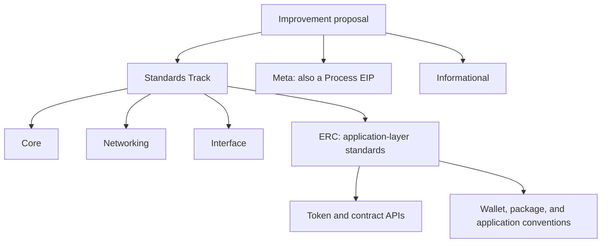
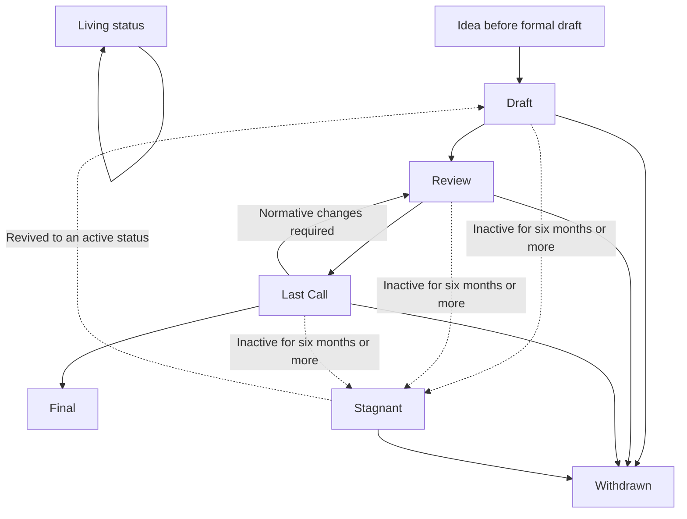

# EIPs and ERCs: A Developer's Guide to Ethereum Standards

**Purpose:** A practical introduction to Ethereum's standards process for smart contract, EVM, protocol, and DeFi developers.

> **Terminology note (checked 24 October 2026):** In the EIP taxonomy, ERC remains the application-level category within the Standards Track. The official repositories have, however, recently separated: protocol and general EIPs are maintained in [ethereum/EIPs](https://github.com/ethereum/EIPs), while application-layer ERCs are maintained in [ethereum/ercs](https://github.com/ethereum/ercs). The separation is organizational; it does not make ERCs unrelated to the wider EIP standards framework. Always check the current registry and contribution instructions before submitting a proposal.

## 1. Why Ethereum Needs Standards

Ethereum is not a single application built by a single team. It is an execution environment used by independent clients, wallets, block explorers, protocols, infrastructure providers, and users. Smart contracts are deployed by different authors, often years apart, and must still be usable by software that their authors did not anticipate.

Without shared conventions, every token could expose a different method to transfer balances, every wallet could need custom logic for every token, and every lending market could require bespoke adapters for every vault. Each integration would become a one-off engineering project. That raises development and audit costs, creates more places for integration bugs, and makes it harder for new applications to use existing on-chain assets.

Standards reduce this coordination problem. They define shared interfaces, terminology, and behavioral expectations so independently developed systems can make compatible assumptions.

### Interoperability is more than matching function names

Two contracts are not interoperable merely because they expose functions with similar names. Callers need to agree on the function signatures, argument and return types, events, failure behavior, and important semantics. For example, a token interface is only useful if `transfer` has a predictable meaning, allowances behave as specified, and transfer events describe the state changes that occurred.

A standard narrows the range of behavior that integrators must handle. It does not eliminate every implementation-specific edge case, but it creates a common baseline.

### Composability creates network effects

A token that follows a widely used token standard can be integrated into wallets, decentralized exchanges, portfolio trackers, lending protocols, and other applications without each integrator inventing a new interface. A tokenized vault that follows a common vault interface is easier for aggregators and other protocols to inspect and use.

This is one reason standards are economic infrastructure, not just documentation. They reduce the cost of connecting independent systems and let developers build on other developers' work. Ethereum.org's [standards overview](https://ethereum.org/developers/docs/standards/) describes interoperability between clients and wallets, and composability between contracts and dapps, as core reasons standards exist.

### Standards also coordinate decentralized development

In an open ecosystem, no single company can require every client, wallet, protocol, and developer to adopt a particular design. A standard provides a shared proposal, an explicit technical specification, a place for review, and a record of design decisions. Adoption still depends on the relevant implementers and users finding the design useful and choosing to support it.

That distinction is fundamental: a standard coordinates people; it does not force them to agree.

## 2. What Is an EIP?

An **Ethereum Improvement Proposal (EIP)** is a design document that communicates an idea to the Ethereum community or specifies a feature, change, standard, or process. According to [EIP-1: EIP Purpose and Guidelines](https://eips.ethereum.org/EIPS/eip-1), an EIP should provide a concise technical specification and a rationale. It is also a versioned record of the design discussion and the decisions made during the proposal's evolution.

EIPs serve several related purposes:

- **Proposal:** describe a concrete change or standard that people can assess.
- **Review:** collect technical feedback, objections, alternatives, and corrections.
- **Specification:** state what independent implementations must do to be compatible.
- **Coordination:** give developers and implementers a shared reference when discussing implementation and adoption.
- **Historical record:** retain the proposal's text and revision history.

An EIP is not automatically a feature in the Ethereum network. A written proposal, an implementation, a deployment, and ecosystem adoption are different milestones.

### Four milestones that developers must distinguish

1. **Specified:** the proposal describes behavior. It may still be a draft and could change.
2. **Implemented:** one or more codebases implement the specification. An implementation may still contain defects or may implement only part of the proposal.
3. **Activated or deployed:** where relevant, the change has been activated in a network, or a contract implementing a standard has been deployed. For protocol changes this may require coordinated client releases and a network upgrade; an application-level contract standard has a different deployment path.
4. **Adopted:** wallets, protocols, developers, and users actually rely on it. Adoption is an ecosystem fact, not something proven by a status label alone.

These four milestones are explanatory concepts, not official EIP status labels. The formal proposal statuses are covered in Section 5.

For a Core EIP, implementation by clients and coordination around a network upgrade matter. For an ERC, adoption may mean that contracts implement it and other applications integrate those contracts. Neither path is identical to the other, even though both use a standards process.

## 3. EIP Types and Categories

EIP-1 defines three top-level EIP types: Standards Track, Meta, and Informational. Standards Track proposals are further divided into four categories. These labels describe the kind of proposal, not a ranking of importance.

### Standards Track

A Standards Track proposal defines a change or standard that affects Ethereum implementations or application interoperability. The main categories are:

- **Core:** changes to protocol rules, including changes that require a consensus fork, as well as other subjects relevant to core protocol development. Core proposals matter to execution or consensus clients and can affect block or transaction validity.
- **Networking:** specifications for peer-to-peer networking and related network protocols. Networking changes matter to client and infrastructure developers, even when they do not alter smart contract source code directly.
- **Interface:** standards for the interfaces through which software interacts with Ethereum, including client APIs/RPC and certain language-level or contract-interface conventions. Wallet, node, tooling, and infrastructure developers should pay attention to relevant interface proposals.
- **ERC:** application-layer standards and conventions, including contract APIs, token standards, and other conventions used by dapps. Solidity developers and protocol integrators encounter ERCs frequently.

### Meta and Process EIPs

A **Meta EIP** describes a process surrounding Ethereum or proposes a change to a process, event, tool, or development environment. EIP-1 also classifies every Meta EIP as a **Process EIP**. Therefore, `Meta` is the top-level type in the EIP metadata; `Process EIP` is not a fourth top-level type. Process EIPs apply a standards-style process outside the Ethereum protocol itself and may require community agreement. Unlike Informational EIPs, they are not merely optional technical advice that users are always free to ignore.

### Informational

An Informational EIP documents a design issue, guideline, or information for the community without proposing a new feature. It does not necessarily represent a community recommendation or consensus. Readers should understand its content and context rather than assume the document creates mandatory behavior.

### A map of EIP types and Standards Track categories

**Important repository detail:** ERC remains a Standards Track category in the taxonomy, but the official authoring repositories have recently split. The [EIPs repository](https://github.com/ethereum/EIPs) directs new ERC work to the [ERCs repository](https://github.com/ethereum/ercs). The categories are conceptually related; the contribution destination is different. The [official EIP-1 document](https://eips.ethereum.org/EIPS/eip-1) is the starting point for understanding the overall proposal framework.

## 4. What Is an ERC, and How Does It Relate to EIPs?

**ERC** stands for **Ethereum Request for Comments**. ERCs describe standards and conventions primarily at the application layer: how a token contract exposes its API, how a wallet discovers an interface, how a vault represents shares in an underlying asset, or how applications can rely on a common contract behavior.

The critical distinction is **scope**. A Core EIP can change protocol-level rules or behavior across Ethereum clients. An ERC generally standardizes a convention that application contracts and the software around them can implement. An ERC does not normally change what counts as a valid Ethereum block or require every node to change its consensus behavior.

### Are EIPs and ERCs two unrelated systems?

No. The terms describe related concepts at different levels. In the EIP taxonomy, ERC is an application-level category under the Standards Track. The same proposal process and lifecycle concepts are used across EIPs and ERCs, as described in [EIP-1](https://eips.ethereum.org/EIPS/eip-1) and the official [ERC repository](https://github.com/ethereum/ercs).

There is an important historical wrinkle: ERC specifications have often appeared on the canonical EIP website at URLs such as `https://eips.ethereum.org/EIPS/eip-20`, and their preamble identifies the category as ERC. This is why developers commonly say **ERC-20**, while its historical document identifier and URL contain **EIP-20**. The number is the same; the conventional name tells you that it is an application-layer standard.

The official repositories have recently separated, so do not infer the submission destination from an old URL. For a new application-layer standard or an update to an existing one, follow the instructions in [ethereum/ercs](https://github.com/ethereum/ercs). For other EIPs, follow [ethereum/EIPs](https://github.com/ethereum/EIPs).

### Five useful examples

The examples below illustrate different types of standards. Their linked official specifications currently label them **Final**; status labels can change, so check the current page when building against a standard.

#### ERC-20 — fungible token interface

[ERC-20](https://eips.ethereum.org/EIPS/eip-20) defines a common API for fungible tokens: assets whose units are treated as interchangeable. It standardizes core functions such as `transfer`, `balanceOf`, `totalSupply`, `approve`, `allowance`, and `transferFrom`, along with `Transfer` and `Approval` events. This allows wallets, exchanges, and protocols to interact with many token contracts through a common interface.

Developer lesson: read the behavioral requirements, not just the list of function signatures. The standard explicitly says callers must handle a returned `false` from specified operations; callers must not assume it can never happen. Metadata such as `name`, `symbol`, and `decimals` is optional in the original ERC-20 specification, so integrations should not treat it as universally guaranteed.

#### ERC-721 — non-fungible token interface

[ERC-721](https://eips.ethereum.org/EIPS/eip-721) standardizes an API for tracking and transferring individually distinct tokens, commonly called NFTs. Each token has its own identifier and ownership state. A fungible-token balance model alone cannot express the ownership and transfer semantics of separately identifiable assets.

Developer lesson: ERC-721 demonstrates that a standard must model the asset's domain. It also relies on ERC-165 for interface detection, and safe transfer behavior involves recipient-contract checks. A contract that merely resembles the ERC-721 API is not enough; integrations should evaluate the full specified behavior and any caveats.

#### ERC-165 — standard interface detection

[ERC-165](https://eips.ethereum.org/EIPS/eip-165) specifies how a contract can report which interfaces it supports through `supportsInterface(bytes4 interfaceId)`. Its interface identifier is calculated from function selectors using XOR. This makes interface discovery possible without requiring an integrator to know a contract's complete implementation in advance.

Developer lesson: interface detection improves discovery, but it is self-reported. A malicious or incorrect contract can claim support for an interface without faithfully implementing its behavior. Treat a positive response as a useful signal, not a security audit.

#### ERC-4626 — tokenized vaults

[ERC-4626](https://eips.ethereum.org/EIPS/eip-4626) standardizes an API for vault shares backed by a single underlying ERC-20 token. It defines deposit, mint, withdraw, and redeem flows, as well as methods for previewing conversions and understanding limits. The aim is to reduce custom adapters between yield-bearing vaults and aggregators, lending markets, and other protocols.

Developer lesson: ERC-4626 is especially useful for DeFi because common interfaces make vault integration more predictable, but it does not standardize a vault's investment strategy, guarantee a yield, or prove that its accounting is safe. Rounding, share-price manipulation, donation/inflation scenarios, asset behavior, fees, and implementation-specific access controls still require careful review. The specification itself warns integrators to examine implementations for ways user deposits could be lost.

#### EIP-1559 — protocol-level transaction fee market

[EIP-1559](https://eips.ethereum.org/EIPS/eip-1559) is categorized as a **Core** proposal rather than an ERC. It introduced a base-fee mechanism that adjusts with block usage, burns the base fee, and separates the maximum total fee a sender will pay from the priority fee offered to encourage inclusion. It changes transaction and protocol behavior rather than defining a token contract interface.

Developer lesson: not every important Ethereum standard is an ERC. If a change affects transaction formats, execution rules, or client behavior, it belongs to a different problem space from application-level contract interfaces.

## 5. How a Proposal Evolves

EIP-1 defines statuses for the proposal lifecycle. The status describes a proposal's stage in the process; it is not a complete verdict about security, implementation quality, or adoption.

This is a simplified lifecycle, not a mandatory linear path. `Idea` is pre-draft and is not tracked in the repository, so it cannot itself be `Withdrawn`; withdrawal applies to a formal proposal. A proposal may become `Stagnant` after at least six months of inactivity in Draft, Review, or Last Call, and authors or editors may restore it to Draft or its previous active status. `Living` is a special status for documents intended to evolve continuously, not a stage every proposal passes through.

### Idea

An idea is pre-draft and is not tracked as a formal proposal in the EIP repository. The author should first research prior work and discuss whether the problem merits standardization. An initial community discussion can expose duplicated work, missing stakeholders, or a solution that is better handled in application code.

### Draft

Draft is the first formally tracked stage. An editor checks whether the submission is properly formatted and sufficiently complete for the repository. Being merged as Draft does **not** mean the proposal has passed technical peer review, been implemented, or gained broad support.

### Review

The author marks a proposal as ready for peer review. Technical reviewers and affected implementers can examine its assumptions, specification, compatibility, edge cases, security considerations, and alternatives. Changes are normal at this stage.

### Last Call

Last Call is the final review window before a proposal may move to Final. The specification should be stable, and the proposal includes a review deadline—typically around 14 days under the published process. If feedback requires normative changes, the proposal returns to Review instead of proceeding unchanged.

### Final

Final means the document is treated as the final standard and should normally be changed only to correct errors or add non-normative clarification. For Core proposals, client implementation is a significant condition for finalization. For an application standard, Final does not guarantee that all relevant contracts implement it, that every integration handles it correctly, or that it is safe to adopt without review.

### Stagnant

A proposal in Draft, Review, or Last Call can be moved to Stagnant after at least six months of inactivity under the process described in EIP-1. It can be revived by its authors or editors by returning it to an earlier active status. Stagnant is not the same as rejected; it signals that the proposal has not been actively progressed.

### Withdrawn

The author or authors have withdrawn the proposal. The process gives this state finality for that number; pursuing the idea again requires a new proposal rather than reviving the withdrawn number.

### Living

Living is for documents intended to be updated continually rather than become fixed. [EIP-1](https://eips.ethereum.org/EIPS/eip-1) itself is the familiar example.

### What the lifecycle does—and does not—tell you

The lifecycle helps you understand the maturity of the specification and how much review remains. It does not replace technical due diligence. When considering a proposal, examine its implementation status, tests, deployment or activation context, integration support, and unresolved risks independently from the status label.

## 6. How to Read an EIP or ERC Specification

A standard is a contract between implementers. The goal is not simply to communicate the author's intent; it is to make it possible for independent teams to build compatible implementations. The normative parts of the specification are therefore more important than a blog post, a short summary, or a code sample alone.

Common sections include:

- **Preamble / metadata:** the proposal number, title, authors, status, type/category, creation date, discussion location, and dependencies. The `requires` field should identify dependencies that are needed to understand or implement the proposal, not every related document mentioned in passing.
- **Abstract:** a compact technical summary of what the proposal specifies.
- **Motivation:** why the problem matters and why existing behavior is insufficient. This helps a developer decide whether the proposal solves a problem relevant to their project.
- **Specification:** the normative behavior—required methods, input and output formats, state transitions, error handling, constraints, events, or protocol rules. Read this carefully and translate each requirement into tests.
- **Rationale:** why the design was chosen, including trade-offs, alternatives, and concerns raised during discussion. Rationale is useful context, but it should not silently override the normative specification.
- **Backwards Compatibility:** what breaks for existing software, how compatibility is preserved, and what migration may be required. It is particularly important when adopting new protocol rules or extending a widely integrated interface.
- **Security Considerations:** threat models, assumptions, attack surfaces, and implementation pitfalls. A missing or shallow security discussion is a reason to slow down, not a reason to assume there are no risks.
- **Test Cases:** examples or vectors that demonstrate expected behavior. Test cases are particularly important for consensus-critical changes, where different implementations must reach the same result.
- **Reference Implementation:** when provided, example code can help explain the specification, but should not automatically be treated as an audited or production-ready implementation.
- **Copyright and licensing:** the official EIP guidelines require a copyright waiver using CC0 language. Check the current template and repository instructions when writing a proposal.

EIP-1 specifies that a Security Considerations section is required. It also explains the metadata preamble and the expected contents of an EIP. See [EIP-1's sections on proposal contents and formatting](https://eips.ethereum.org/EIPS/eip-1).

### Normative versus explanatory text

Normative language expresses requirements. Words such as **MUST**, **MUST NOT**, **SHOULD**, **SHOULD NOT**, and **MAY** have defined meanings when used according to the referenced RFC conventions. Explanatory text describes motivation, examples, or rationale. It helps readers understand the design, but it is not always a substitute for a precise requirement.

When you implement a standard, turn the normative requirements into a checklist and tests. If an example appears inconsistent with a normative rule, investigate the inconsistency rather than assuming the example is authoritative.

## 7. How Standards Affect Smart Contract Development

### Interfaces, ABI, and function selectors

A Solidity interface describes the callable surface expected by a caller. The ABI defines how function calls and return values are encoded. For externally callable functions, a function selector is the first four bytes of the Keccak-256 hash of the canonical function signature—for example, the signature `transfer(address,uint256)` maps to selector `0xa9059cbb`.

A selector is not a complete behavior specification. It does not encode return types, access control, economic meaning, reentrancy guarantees, or state invariants. Two functions can share the same selector yet behave differently. Standards specify the shared expectations surrounding the interface as well as the function names.

### Token transfers and approvals

ERC-20 offers two important interaction patterns: direct transfer and allowance-based spending. An integrator must understand how `approve`, `allowance`, and `transferFrom` work, what return values mean, and which events should be emitted. A front end that displays a successful transaction based only on the transaction receipt, without considering return behavior and token-specific semantics, may misrepresent what happened.

Some real-world token contracts have non-standard behavior. Integration libraries can normalize known quirks, but a wrapper cannot prove that an arbitrary token is economically safe or semantically honest. Developers should explicitly decide which token behaviors their protocol supports and test those assumptions.

### Events and off-chain indexers

Events let indexers, explorers, and applications observe contract activity without reading every storage slot. A standard can define when events must be emitted, which values are indexed, and what those values mean. A contract that updates state but emits misleading or missing events may technically expose callable methods while breaking expected off-chain workflows.

Events are not a substitute for on-chain state checks. Integrators should use them for discovery and history while verifying critical state on-chain when needed.

### Interface detection

ERC-165 provides a common way to query support for a declared interface. In Solidity, a standardized interface identifier is often computed from the XOR of function selectors. Interface detection helps applications choose an integration path, but it is self-reported: a contract can claim support incorrectly or implement the functions with unsafe semantics. Detection is a compatibility signal, not an audit result.

### DeFi composability and vault accounting

ERC-4626 is a concrete example of how a standard can reduce integration friction. A vault can expose common deposit, mint, withdraw, and redeem operations. An aggregator can call a known method rather than implement a custom adapter for each vault design.

However, the standard does not prescribe the vault's strategy or guarantee profit. A developer still needs to analyze its accounting model, rounding directions, limits, conversion previews, asset assumptions, fees, access control, and failure modes. Similarly, a lending protocol integrating a token should assess whether that token's transfer and balance semantics are compatible with collateral accounting.

### Backwards compatibility and extensibility

A standard is most useful when existing integrators can rely on it for a long time. New optional functions or extensions should be designed so older integrations do not unexpectedly break. If a proposal changes existing semantics, developers need a migration strategy and tests for both legacy and new behavior. In DeFi, seemingly small differences in rounding or accounting can affect solvency, so behavioral compatibility can matter as much as ABI compatibility.

### Interface compliance is not implementation correctness

A contract may implement every required method but still:

- violate an economic invariant;
- expose a reentrancy or authorization bug;
- report values that are inconsistent with its state;
- emit events that do not accurately reflect state changes;
- make unsafe assumptions about the underlying asset;
- behave unexpectedly for unusual token implementations or edge cases.

Standards define a compatibility baseline. Security review, code review, adversarial testing, and economic analysis remain separate responsibilities.

## 8. A Developer's Checklist for Evaluating a Standard

Use this checklist before choosing an EIP or ERC for a project, writing an integration, or adopting a new protocol feature.

1. **Problem:** What exact problem does it solve? Is the problem real for your use case, or is the proposal adding complexity without meaningful interoperability benefits?
2. **Scope:** Is it an application-level convention, a client/API change, a network protocol change, or a consensus change? Does it affect your contracts, your off-chain software, or both?
3. **Normative requirements:** Which methods, events, state transitions, rounding rules, errors, and edge cases are mandatory? Translate them into a test checklist.
4. **Status and revisions:** Is it Draft, Review, Last Call, Final, Stagnant, Withdrawn, or Living? What has changed recently? Do not use old tutorials as a substitute for the current specification.
5. **Compatibility:** What assumptions do existing wallets, contracts, or protocols make? Does an extension preserve old behavior? Are migration or fallback paths needed?
6. **Security and trust assumptions:** What can an adversary control? What assumptions are made about external contracts, token behavior, or off-chain components? Are attack scenarios addressed in the specification and implementation?
7. **Cost and complexity:** What additional storage, calls, gas costs, client complexity, or operational costs result? Is the benefit worth those costs for your target environment?
8. **Dependencies:** Does the specification depend on another EIP/ERC or a particular protocol feature? Follow the `requires` references and validate the whole dependency chain.
9. **Implementations and tests:** Are there maintained implementations? Do they have thorough tests and test edge cases? Do independent implementations behave consistently?
10. **Adoption:** Which wallets, protocols, clients, or libraries actually support it? Is the support documented and tested, or merely claimed?
11. **Limitations and alternatives:** What doesn't the standard solve? Are there extensions or alternatives better suited to your application?
12. **Project fit:** Can you satisfy the standard without violating your protocol's invariants or security model? Document any unsupported behaviors and test assumptions explicitly.

### Worked example: evaluating ERC-4626 for a DeFi protocol

Suppose you are integrating a tokenized vault into a lending market or yield aggregator.

**First, establish the fit.** ERC-4626 is designed around shares representing a claim on a single underlying ERC-20 asset. If the vault is asynchronous, multi-asset, or exposes a fundamentally different redemption model, determine whether an extension or another interface is needed rather than assuming plain ERC-4626 covers it.

**Second, read the methods as behavioral requirements.** Review `asset`, `totalAssets`, `convertToShares`, `convertToAssets`, `maxDeposit`, `previewDeposit`, and the deposit/withdraw flows. Pay attention to what is an estimate, what must not revert, how limits are reflected, and which values round up or down. A UI preview and an on-chain maximum are not interchangeable concepts.

**Third, inspect the implementation.** Trace how assets enter the vault, how shares are minted, and how assets leave. Test small deposits, empty-vault initialization, rounding boundaries, fee-on-transfer or rebasing-like asset behavior if the protocol claims to support it, and changes in deposit/withdraw limits. Investigate donation/inflation attack scenarios and the mitigations, if any, used by the implementation; do not assume the ERC interface by itself prevents them.

**Fourth, verify integration assumptions.** Confirm whether the vault's assets are accepted collateral, how exchange-rate changes affect solvency, what happens when deposits or withdrawals are paused, and how the integration handles failed or limited withdrawals. A vault can be standards-compliant and still be unsuitable collateral for a particular lending market.

**Decision:** adopt the standard as an interface baseline, not as a substitute for protocol-specific risk assessment. Read the [ERC-4626 specification and security considerations](https://eips.ethereum.org/EIPS/eip-4626), inspect the exact vault implementation and tests, and document the assumptions your integration relies on.

## 9. How to Propose a New EIP or ERC

A new standard is valuable when multiple independent implementations or applications benefit from sharing the same rules. Before writing a proposal, establish that the problem is not already solved by an existing standard, a compatible extension, or a library-level convention.

### A practical path

1. **Research existing work.** Search the official [EIP registry](https://eips.ethereum.org/) and [ERC repository](https://github.com/ethereum/ercs). Read related standards, their dependencies, status, discussion, and known limitations.
2. **Validate the need.** Explain who has the problem, why current tools are insufficient, and which independent parties would benefit from standardization. If the feature is only useful inside one application, a local interface or library may be enough.
3. **Discuss before formalizing.** Use the relevant community discussion venue—EIP-1 recommends early discussion, including on [Ethereum Magicians](https://ethereum-magicians.org/). Early review can reveal prior art and help define the scope.
4. **Choose the right home and category.** Application-layer conventions belong in the ERC process; core protocol, networking, and interface proposals follow the relevant EIP process. Check the current contribution instructions because the official EIP and ERC repositories have separated.
5. **Write a precise specification.** State exact method signatures, inputs, outputs, events, invariants, failure behavior, edge cases, and compatibility constraints. Avoid vague words such as “should be secure” in place of testable requirements.
6. **Explain rationale and alternatives.** Describe why the chosen design is preferable, what trade-offs it introduces, and which alternatives were considered. Define the scope carefully enough that a standards document does not attempt to solve unrelated problems.
7. **Address security from the start.** Identify trust assumptions, adversarial behavior, integration risks, and failure modes. A Security Considerations section is required by EIP-1.
8. **Provide tests and implementation material when appropriate.** Reference implementations and tests help readers validate the design. For consensus-critical changes, test vectors are especially important because clients must converge on the same result.
9. **Invite review and maintain the proposal.** Respond to objections, revise the normative specification when needed, and make sure the text reflects the agreed design. An editor's formatting review is not a substitute for technical consensus.

### Where to contribute

- Start with [EIP-1: EIP Purpose and Guidelines](https://eips.ethereum.org/EIPS/eip-1).
- For application-layer ERC proposals and updates, use [ethereum/ercs](https://github.com/ethereum/ercs).
- For general EIP proposals outside the ERC repository, use [ethereum/EIPs](https://github.com/ethereum/EIPs).
- For community discussion, consult the venue specified in the proposal and the official guidance; [Ethereum Magicians](https://ethereum-magicians.org/) is commonly used for early technical discussion.

Do not treat the submission workflow as a shortcut to recognition. The goal is to document a real need in a form that independent implementers can use to create compatible systems.

## 10. Common Misconceptions

**“Every EIP becomes part of Ethereum.”**  
No. A proposal may remain in Draft, become Stagnant, be Withdrawn, or never be adopted. Writing a specification is not the same as implementation or activation.

**“Every ERC is safe because it is a standard.”**  
No. A standard defines expectations for compatibility; it does not audit a contract, eliminate implementation bugs, or guarantee economic soundness.

**“Final means every wallet and protocol supports it.”**  
No. Final means the specification has reached the process's final state. Actual adoption varies across implementations, applications, and deployments.

**“Implementing an interface guarantees correct behavior.”**  
No. ABI compatibility and declared interface support do not prove that semantics are correct or that the implementation preserves security invariants.

**“EIPs and ERCs are unrelated proposal systems.”**  
No. ERCs are application-layer standards within the wider EIP standards taxonomy and share the general standards framework. The official repositories have recently separated, which changes where contributors submit and maintain the documents—not the historical and conceptual relationship.

**“A new standard automatically makes an older one obsolete.”**  
No. Standards often coexist because they solve different problems or because backwards compatibility matters. An extension may build on an earlier standard rather than replace it.

**“Popularity proves technical quality.”**  
No. Popularity may be evidence of adoption, but it does not replace specification review, security analysis, tests, or project-specific suitability checks.

**“The example implementation is the specification.”**  
No. Implementations can contain bugs, omit edge cases, or make trade-offs. Read the normative requirements and compare the implementation against them.

## 11. A Practical Learning Path

A productive way to learn Ethereum standards is to move from a simple interface to more complex integration and then to protocol-level changes.

1. **Read EIP-1.** Understand proposal types, metadata, statuses, and the lifecycle before focusing on individual standards.
2. **Start with ERC-20.** Trace `balanceOf`, `transfer`, `approve`, `allowance`, `transferFrom`, the events, and return-value expectations. Write tests that check both successful and failing paths.
3. **Study ERC-165 and ERC-721 together.** Learn how interface detection supports interoperability and why detectable support does not guarantee correct semantics.
4. **Study ERC-4626 for DeFi.** Examine share/asset conversions, previews, limits, rounding, deposit/withdraw flows, and security assumptions. Compare the specification to a maintained implementation and tests.
5. **Read EIP-1559 as a contrast.** Identify why it is a Core proposal, what behavior it changes at protocol level, and how the change affects transaction fee semantics and clients.
6. **Read normative sections first, then rationale and tests.** Turn every important requirement into a test. Track ambiguous cases rather than assuming a familiar implementation resolves them.
7. **Inspect related proposals and dependencies.** Use the `requires` references, version history, and related standards to understand compatibility boundaries.
8. **Apply a standard in a small project.** Build a simple integration, test expected and adversarial behavior, and document the assumptions your code makes.

For a DeFi-focused smart contract developer, a good curated set is **ERC-20**, **ERC-165**, **ERC-721**, **ERC-4626**, and **EIP-1559**. Together, these cover a basic fungible asset API, interface discovery, unique-asset ownership, tokenized vaults, and a protocol-level transaction change. The point is not to memorize identifiers; it is to learn how to read a specification, map it to implementation requirements, and identify the boundary between standardization and project-specific risk.

## Further Reading

- [EIP-1: EIP Purpose and Guidelines](https://eips.ethereum.org/EIPS/eip-1) — proposal types, process, status labels, specification format, and contribution guidance.
- [Ethereum Development Standards](https://ethereum.org/developers/docs/standards/) — overview of standards and common token conventions.
- [Ethereum Improvement Proposals repository](https://github.com/ethereum/EIPs) — EIP contribution instructions and protocol/general proposals.
- [Ethereum Request for Comments repository](https://github.com/ethereum/ercs) — current home for application-layer ERC proposals and updates.
- [ERC-20: Token Standard](https://eips.ethereum.org/EIPS/eip-20) — fungible token interface.
- [ERC-721: Non-Fungible Token Standard](https://eips.ethereum.org/EIPS/eip-721) — non-fungible token interface.
- [ERC-165: Standard Interface Detection](https://eips.ethereum.org/EIPS/eip-165) — interface discovery.
- [ERC-4626: Tokenized Vaults](https://eips.ethereum.org/EIPS/eip-4626) — vault API and security considerations.
- [EIP-1559: Fee market change](https://eips.ethereum.org/EIPS/eip-1559) — protocol-level fee-market change.

---

**Research and verification note:** Current taxonomy and lifecycle claims were checked against EIP-1 and the official EIP/ERC repositories. The official pages for ERC-20, ERC-721, ERC-165, ERC-4626, and EIP-1559 were checked for their categories and status labels on 24 October 2026. Repository layout and status labels can evolve; re-check the linked authoritative pages before relying on them in a future revision.
